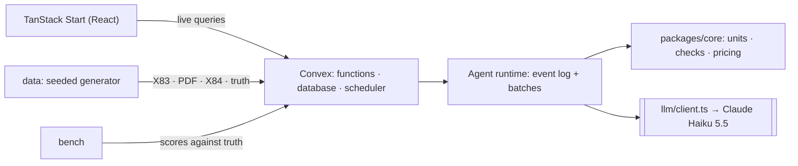

# Preisspiegel

[](https://github.com/Vijay190899/preisspiegel/actions/workflows/ci.yml)
[](LICENSE)
[](https://github.com/Vijay190899/preisspiegel/commits/main)

**Tender pricing where every number points at its source.** An electrical contractor's tender arrives as a Leistungsverzeichnis with around 1,170 positions and a handful of supplier offers. Preisspiegel matches each position to an offer, prices it, and shows the estimator only the positions that need a decision, with the reason and the arithmetic.

> An independent portfolio project. The contractor, the suppliers and the tender are fictional, and all data is synthetic ([docs/DATA.md](docs/DATA.md)).

**Status: in progress.** The foundations (M0) and the data and parsers (M1) are built: a seeded tender of 1,170 positions with three supplier offers and 60 planted traps, read back by a GAEB reader and a PDF table reader that keep the source of every number. A first slice of the interface is in place: the tender overview, a searchable list of all positions, and a source viewer that opens the supplier's PDF at the page a price was read from and marks it. The matching pipeline, the review queue and the public demo follow in M2 to M4. [docs/HANDOVER.md](docs/HANDOVER.md) has the current state and [docs/BUILD_PLAN.md](docs/BUILD_PLAN.md) the gates.

## What it will demonstrate

| Problem                        | How Preisspiegel does it                                                                                                                                                    |
| ------------------------------ | --------------------------------------------------------------------------------------------------------------------------------------------------------------------------- |
| AI an estimator can trust      | The model proposes, code decides. Every extracted attribute carries a verbatim quote that code checks against the source; accept or flag is decided by deterministic checks |
| Catching the expensive mistake | Unit-normalised checks: a cabinet offered as 138 kVA is compared in amps (199 A at 400 V) against the 250 A the tender specifies, and flagged with the arithmetic shown     |
| Every number traceable         | Prices, quantities and labor times are parsed by code, never written by a model, and each one opens the source document at the region it came from                          |
| Attention where it matters     | Routine positions are priced automatically; the rest form a review queue sorted by euros at risk                                                                            |
| Unit economics                 | The cheapest current model does the bulk work, every model role is an environment variable, and every call is metered against a budget                                      |

## Benchmarks

Arrive with milestone M2, measured against ground truth from the generator and committed to [`bench/results/`](bench/results) with provider, model IDs, seeds, n and git SHA.

| ID  | Measures                                                                       |
| --- | ------------------------------------------------------------------------------ |
| B1  | Auto-priced share, auto-accept precision, euro error in auto-accepted lines    |
| B2  | Trap recall per trap type, review-queue precision                              |
| B3  | Displayed numbers that resolve to a source region containing that value        |
| B4  | Matcher alone vs matcher plus escalation: queue size, precision, cost and time |

## Architecture



Details: [docs/ARCHITECTURE.md](docs/ARCHITECTURE.md) · Product: [docs/PRD.md](docs/PRD.md) · Plan: [docs/BUILD_PLAN.md](docs/BUILD_PLAN.md) · Decisions: [docs/DECISIONS.md](docs/DECISIONS.md)

## Models (swappable)

The defaults are tuned for cost. The provider and every role are environment variables, and no role defaults to a larger model:

| Setting                                                   | Default                                    | Override                 |
| --------------------------------------------------------- | ------------------------------------------ | ------------------------ |
| Provider                                                  | OpenRouter (Anthropic-compatible endpoint) | `LLM_PROVIDER=anthropic` |
| Matcher (one call per position)                           | `claude-haiku-5-5`                         | `LLM_MATCH_MODEL`        |
| Escalation (second read of unsettled positions)           | off                                        | `LLM_ESCALATION_MODEL`   |
| Investigator (drafts a resolution for a flagged position) | `claude-haiku-5-5`                         | `LLM_INVESTIGATOR_MODEL` |

Example: `LLM_ESCALATION_MODEL=claude-sonnet-5-5`. See [ARCHITECTURE §5](docs/ARCHITECTURE.md#5-model-layer-built) for the provider mapping, capability flags, price table and budget guards.

## Run locally

Needs Node 24. pnpm comes through Corepack.

```bash
corepack enable
pnpm install
cp .env.example .env.local      # add OPENROUTER_API_KEY
pnpm dev                        # Convex local deployment + web on :3000
pnpm seed load                  # in a second terminal: loads the demo tender into Convex
pnpm check                      # eslint, prettier, tsc, vitest
pnpm probe:llm                  # confirms which LLM features the provider supports
pnpm shots /                    # screenshots at 390 and 1440 px, light and dark
```

The first `pnpm dev` on a machine without a Convex login asks whether to sign in; `CONVEX_AGENT_MODE=anonymous pnpm dev` uses a local deployment with no account. `pnpm seed generate` rewrites the demo files under [`data/seed/`](data/seed) from the seed; [docs/DATA.md](docs/DATA.md) describes them. `pnpm bench` arrives with M2.

## License

MIT
