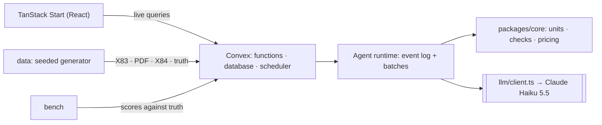

# Preisspiegel

[](https://github.com/Vijay190899/preisspiegel/actions/workflows/ci.yml)
[](LICENSE)
[](https://github.com/Vijay190899/preisspiegel/commits/main)

**Tender pricing where every number points at its source.** An electrical contractor's tender arrives as a Leistungsverzeichnis with around 1,170 positions and a handful of supplier offers. Preisspiegel matches each position to an offer, prices it, and shows the estimator only the positions that need a decision, with the reason and the arithmetic.

> An independent portfolio project. The contractor, the suppliers and the tender are fictional, and all data is synthetic ([docs/DATA.md](docs/DATA.md)).

**Status: in progress.** Built so far: a seeded tender of 1,170 positions with three supplier offers and 60 planted traps; a GAEB reader and a PDF table reader that keep the source of every number; the matching pipeline with its agent runtime; the benchmarks below; and an interface that shows the tender as the building it is for, one window per position, lit when it is priced and red when it needs a decision; lists what needs a decision by the euros at stake; sets the suppliers side by side; and opens the supplier's PDF at the place a price was read. Labor pricing, the copper surcharge, run replay and the public demo follow in M3 and M4. [docs/HANDOVER.md](docs/HANDOVER.md) has the current state and [docs/BUILD_PLAN.md](docs/BUILD_PLAN.md) the gates.

## What it will demonstrate

| Problem                        | How Preisspiegel does it                                                                                                                                                    |
| ------------------------------ | --------------------------------------------------------------------------------------------------------------------------------------------------------------------------- |
| AI an estimator can trust      | The model proposes, code decides. Every extracted attribute carries a verbatim quote that code checks against the source; accept or flag is decided by deterministic checks |
| Catching the expensive mistake | Unit-normalised checks: a cabinet offered as 138 kVA is compared in amps (199 A at 400 V) against the 250 A the tender specifies, and flagged with the arithmetic shown     |
| Every number traceable         | Prices, quantities and labor times are parsed by code, never written by a model, and each one opens the source document at the region it came from                          |
| Attention where it matters     | Routine positions are priced automatically; the rest form a review queue sorted by euros at risk                                                                            |
| Unit economics                 | The cheapest current model does the bulk work, every model role is an environment variable, and every call is metered against a budget                                      |

## Benchmarks

Measured against ground truth from the generator and committed to [`bench/results/`](bench/results) with provider, model IDs, seed, n and git SHA. The model is `claude-haiku-5-5` at effort `low`; a full run costs about 40 cents.

The prompt and the checks were worked on while looking at the demo tender, so the column to judge by is the **unseen tender**: generated from another seed, run once, scored. Two independent audits then showed that the search and the attribution had been fitted to the tenders they were worked on; the column is from a tender generated after both were fixed (seed 502). The two earlier unseen runs are kept beside it.

| ID  | Measures                                                   | No reader | First run      | Unseen tender          |
| --- | ---------------------------------------------------------- | --------- | -------------- | ---------------------- |
| B1  | Positions priced without a person (expected)               | 84.9%     | 85.6% (91.4%)  | **91.6%** (91.8%)      |
| B1  | of those, rightly so                                       | 97.5%     | 99.8%          | **100%**               |
| B1  | Euro error over what was priced without a person           | 53,218 €  | 196 €          | **170 €** of 770,755 € |
| B2  | Planted traps found on their line                          | 39 of 60  | 54 of 60       | **60 of 60**           |
| B2  | Expected reviews found                                     | 72.8%     | 98.0%          | **100%**               |
| B2  | Reviews raised that belong in the queue                    | 37.9%     | 58.9%          | **98.0%**              |
| B3  | Numbers the readers took from a file, found at their place | —         | 6,567 of 6,577 | **6,559 of 6,559**     |

- **No reader** reads no text and trusts every position reference: what a few plain rules amount to. **First run** is the first full run, kept in `bench/results/baseline/` before anything was changed in response to it.
- On the demo tender itself the pipeline now agrees with the ground truth on every position, which is what tuning on a tender buys and not a result.
- What went wrong on the unseen tender: two needless reviews, where the model left open a line that names its position, and one luminaire priced at the second-cheapest valid offer.
- One run is one tender. With flawless reading and no model (`pnpm bench:seeds`), the checks agree with the ground truth on every position of **780 of 797** further unseen tenders (97.9%), price a position that needed a person on 2.0% of them and miss a planted trap on 4.3%. Those figures pool one range run here with four an independent audit chose; the range run here alone gave 198 of 200, the best of the five.
- [docs/DATA.md](docs/DATA.md#what-the-benchmarks-show) has the full table, all three unseen runs, what the two audits found, and the failures written up.
- B4 (matcher alone against matcher plus a larger model) is not run. All three errors on the unseen tender start in the model's answer, so a larger model might fix them; trying it on those positions would cost a few cents and has not been done.

## Architecture



Details: [docs/ARCHITECTURE.md](docs/ARCHITECTURE.md) · Product: [docs/PRD.md](docs/PRD.md) · Plan: [docs/BUILD_PLAN.md](docs/BUILD_PLAN.md) · Decisions: [docs/DECISIONS.md](docs/DECISIONS.md)

## Models (swappable)

The defaults are tuned for cost. The provider and every role are environment variables, and no role defaults to a larger model:

| Setting                                                   | Default                                    | Override                 |
| --------------------------------------------------------- | ------------------------------------------ | ------------------------ |
| Provider                                                  | OpenRouter (Anthropic-compatible endpoint) | `LLM_PROVIDER=anthropic` |
| Matcher (one call per distinct question)                  | `claude-haiku-5-5`                         | `LLM_MATCH_MODEL`        |
| Escalation (second read of unsettled positions)           | off                                        | `LLM_ESCALATION_MODEL`   |
| Investigator (drafts a resolution for a flagged position) | `claude-haiku-5-5`                         | `LLM_INVESTIGATOR_MODEL` |

Example: `LLM_ESCALATION_MODEL=claude-sonnet-5-5`. See [ARCHITECTURE §5](docs/ARCHITECTURE.md#5-model-layer-built) for the provider mapping, capability flags, price table and budget guards.

## Run locally

Needs Node 24. pnpm comes through Corepack.

```bash
corepack enable
pnpm install
cp .env.example .env.local      # add OPENROUTER_API_KEY
pnpm dev                        # Convex local deployment + web on :3000
pnpm seed load                  # in a second terminal: loads the demo tender into Convex
pnpm check                      # eslint, prettier, tsc, vitest
pnpm probe:llm                  # confirms which LLM features the provider supports
pnpm shots /                    # screenshots at four widths, night and day
pnpm bench:seeds                # the model-free reference runs on other tenders, no cost
```

The first `pnpm dev` on a machine without a Convex login asks whether to sign in; `CONVEX_AGENT_MODE=anonymous pnpm dev` uses a local deployment with no account. `pnpm seed generate` rewrites the demo files under [`data/seed/`](data/seed) from the seed; [docs/DATA.md](docs/DATA.md) describes them. `pnpm bench` scores the newest run against the ground truth; `pnpm bench --start` and `pnpm bench:heldout` call the model and cost about 40 cents a run.

## License

MIT
