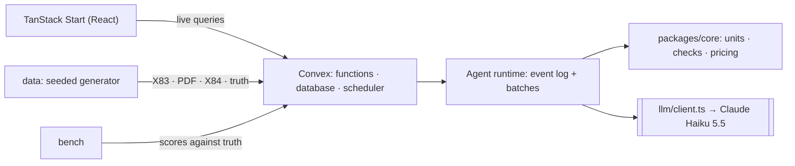

# Preisspiegel — Technical Architecture

Each section says whether it is **built** or **planned**. [HANDOVER](HANDOVER.md) has the current state.

## 1. System overview



The web app subscribes to Convex queries, so every row updates as the run writes it. The agent runtime is Convex functions: actions call the model, mutations write the event log, and the scheduler chains the batches. All judgment that decides accept or flag is pure code in `packages/core`.

## 2. Repository layout (built)

```
apps/web/              TanStack Start app: routes, components, styles/tokens.css
services/backend/      Convex project: convex/schema.ts, convex/llm/, later agent/ pipeline/ ingest/
packages/core/         Pure TypeScript shared by backend, bench and generator
data/                  Seeded generator and data/seed/ (committed demo files)
bench/                 Benchmarks, the provider probe, bench/results/*.json
docs/                  PRD, ARCHITECTURE, BUILD_PLAN, DECISIONS, DATA, DEMO_SCRIPT, HANDOVER
scripts/               Gate tooling: screenshot.ts
```

### Task runner

Root `package.json` scripts are the only entry points.

| Command                 | Does                                                                                                   |
| ----------------------- | ------------------------------------------------------------------------------------------------------ |
| `pnpm check`            | ESLint, Prettier, typecheck of every project, Vitest                                                   |
| `pnpm dev`              | Convex (local deployment) and the web dev server on :3000                                              |
| `pnpm build`            | Production build of the web app                                                                        |
| `pnpm shots [path ...]` | Screenshots at 390, 1024, 1280 and 1440 px, night and day; fails on console errors or overflow         |
| `pnpm probe:llm`        | One cheap call per provider capability; writes `bench/results/provider_probe.json`                     |
| `pnpm env:push`         | Copies `.env.local` to the Convex deployment's environment                                             |
| `pnpm demo:reset`       | Takes back every decision and reads the stored answers once more; no model is called                   |
| `pnpm seed`             | Writes `data/seed/` from the seed, parses it back and loads Convex. `generate` and `load` run one half |
| `pnpm bench`            | M2                                                                                                     |

## 3. Backend (services/backend)

**Built:** the model layer (§5); typed deployment env in `convex/convex.config.ts`; the tender tables, loaded by `pnpm seed`; the agent runtime in `convex/agent/`; and the queries the interface reads in `tenders.ts`, `positions.ts` and `runs.ts`.

| Table                   | Holds                                                                                                          |
| ----------------------- | -------------------------------------------------------------------------------------------------------------- |
| `tenders`, `documents`  | A tender and its source files, with line counts                                                                |
| `positions`             | LV positions: ordinal number, title path, short and long text, quantity, unit                                  |
| `offerLines`            | Supplier lines as read from the document, with the source of every field                                       |
| `runs`                  | One run: state, how far it has read, calls, cost, and at the end the totals and one status letter per position |
| `runEvents`             | What happened in a run, in order. Append-only                                                                  |
| `questions`             | Per run and position: the lines that could answer it, and a hash of everything the model is shown              |
| `judgements`            | Per run and position: the verified answers                                                                     |
| `matches`               | Per run and position: the decision, the reasons, every offer with its findings and evidence                    |
| `matchCache`            | What a model answered to a question, by the question's hash. Outlives runs and reloads                         |
| `llmLedger`, `llmSpend` | Every model call, and the running total per day                                                                |

Rows refer to their tender by slug (ADR-15).

**Agent runtime** (`convex/agent/run.ts`, about 680 lines, no framework). A run is three kinds of step, four where the escalation role has a model, each scheduled by the one before it:

1. **`prepare`** works out, for every position, which lines could answer it, and stores the questions.
2. **`read`** takes the next 30 positions, has the model read the questions nobody has answered before (eight calls side by side), checks every answer against its sources, and stores answers, new cache entries, ledger rows and events in one transaction. Then it schedules itself again.
3. **`escalate`**, only where `LLM_ESCALATION_MODEL` is set: the questions on which the matcher left a line unconfirmed (it was unsure, its quotes did not hold, or the call failed) go once more to the larger model, eight at a time, capped at a fifth of the tender's positions (`planEscalation` in core). Positions that share a question name different lines, so the answer is verified against each asking position's own lines, and it is taken only for the lines the matcher left unconfirmed (`mergeEscalated`); where it has no answer, the first reading stays. A budget reached here ends the second reading and the run goes on to decide what the matcher read. The run's status is `escalating`, and the watchdog counts its progress. B4 measured it on one tender; it is off until measured on more (ADR-71).
4. **`decide`** runs the checks and the triage over everything that was read, and stores a decision per position.

- A step that runs twice writes nothing the second time: storing a batch is guarded by the run's cursor.
- A step that throws marks the run failed with the reason. A model call that fails does not: it comes back as a value and the lines it was about stay unconfirmed. That sends a position to review only if it leaves the position without a clean cheapest offer. A position another supplier answers cleanly is still priced, and the unread line is dropped without a note (open item: say so on the position).
- Before each batch the run checks its own spend against `RUN_MAX_USD` and the day's against `LLM_DAILY_BUDGET_USD`, and stops itself with a note. The most a run can overshoot is one batch.
- Calls are recorded per batch, in the transaction that stores their results, so side-by-side calls do not contend for the day's total.
- Equal questions share an answer. The hash covers the prompt version, the model and everything shown, with lines numbered by position in the list instead of by id, so the same article asked for on seven floors is read once. The full demo tender has 1,170 positions and about 880 distinct questions, so a run on an empty cache makes about that many calls and a run on a warm one none. The key covers a prompt version that is kept by hand, not the prompt's text (open item).
- A run has a mode. `live`: the model reads what nobody has read. `replay`: the stored answers are read back, every one is checked against its sources again and the triage decides again, and no model is called; a question without a stored answer stays unread. A replay pauses 450 ms between batches so it can be watched, about 20 s for the tender. `runs:start` is the one thing the interface may start: a replay for anyone, a live run only with `DEMO_ACCESS_CODE` (`agent/gate.ts`, tested: five wrong codes per browser in ten minutes and that browser's codes are no longer read; past 300 wrong codes an hour overall a wrong code is answered as locked, but the right one still gets in; three read-backs per browser in ten minutes; limits counted by the Convex rate limiter, ADR-63, 67), and one run of a tender at a time. `pnpm bench --start` starts a live run from the command line; `pnpm demo:reset` takes back every decision and replays once.
- A watchdog looks at each run and each labor pass every twelve minutes (longer than an action may run) and marks it failed if it stands exactly where it stood, so a step that died cannot leave a run reading for good. When a run finishes, the runs before it are cleared; the answers stay in the cache.
- The interface reads `runs:latest`, `runs:statuses`, `runs:match`, `runs:reviewQueue` and `runs:events`, all live.
- Reloading a tender clears its runs; the answer cache stays.

## 4. Pipeline (built, in `packages/core/src/pipeline.ts`)

```
positions, offer lines
  ─► buildQuestions   lines that name the position, a text search over those that name none,
                      and lines whose quantity is the total of the position's kind (ADR-45, 48)
  ─► the matcher      per line: same, different, unrelated or unsure, with compared attributes and a quote for each
  ─► verifyAnswer     every quote looked up in its source; values compared by arithmetic where they can be
  ─► assess           unit, arithmetic, quantity and ambiguity checks per line
  ─► attribute        a line that names no position is tied to the positions its quantity accounts for
  ─► decide           a position needs a person exactly when its cheapest offer is not a clean one
```

Every step is a pure function, tested without a database or a model. The runtime calls them; so do the benchmarks.

**The model proposes, code decides.**

- The matcher (`convex/agent/prompt.ts`) gets one position and up to about eight lines, and answers in a fixed schema. It is told never to convert or calculate.
- `verifyAnswer` throws out any compared attribute whose quote is not in its source word for word, or whose value is not in its quote. A line called "the same" with no attribute left standing is not confirmed.
- `compareValues` (`measure.ts`) then compares the two values itself where it can: two measures of the same kind after conversion, a current against an apparent power at 400 V three-phase, codes as text. Its result stands whatever the model said. That is how a line the model calls "the same" becomes a `SPEC_MISMATCH` with `138 kVA / (√3 × 400 V) = 199 A` attached.
- Prices, quantities and totals are the ones the readers parsed. Two things the model writes do reach the page. The values it compared are shown beside the words it read them from, and code has checked that those words are in the source. A pack size divides a price, and is accepted only with a quote that is in the line. Both checks are by substring, which is weaker than it sounds (open item in [HANDOVER](HANDOVER.md)).

**Search without a model.** Lines that name no position are found by Okapi BM25 over words, numbers and the four-letter pieces of longer words (`Leitungsschutzschalter` and `LS-Schalter` share `scha`), three per supplier. A result is put to the model only if it scores at least half of what its line reaches for any position.

**Reason codes:** `SPEC_MISMATCH`, `UNIT_BASIS`, `PRICE_OUTLIER`, `QTY_MISMATCH`, `ALTERNATIVE_PRODUCT`, `NO_OFFER`, `AMBIGUOUS`, `ARITHMETIC`. A finding carries the code and the figures behind it; the interface puts it into words (`apps/web/src/lib/findings.ts`).

**The decision** per position: the cheapest clean offer is the price; findings on dearer offers are noted; a finding on an offer that is cheaper, or has no price per unit, or is the only one, makes it a review. `atRisk` is the difference between the clean price and the cheaper flagged one, times the quantity. [DATA](DATA.md#what-the-ground-truth-says) states the rule and where it falls short.

**Labor** is a pass of its own over the tender (`convex/agent/labor.ts`), because it does not depend on the offers: batches of 40 positions, eight calls side by side, an answer cache keyed by a hash of the instructions, the table, the model and the position, the ledger and the day's budget, and a replay mode that calls nothing. The model proposes an entry of the contractor's labor time table and quotes the position (`agent/laborPrompt.ts`, the table without its minutes in the cached prefix); `assessLabor` in `packages/core/src/labor.ts` decides (unit, size or count from the label, quotes at word boundaries) and the minutes are read from the table. A position whose labor cannot be checked goes to a person. ADR-59.

**Also in `packages/core`:**

- `gaeb.ts` reads and writes GAEB DA XML 3.2, phases 83 and 84, and turns a file into positions or offer lines. Formatted text is read as it stands in the file, so words and markup keep their order. `readGaeb` also returns what it had to assume.
- `pdfTable.ts` reads an offer table out of PDF text. It finds the header row by what German offers call their columns, works out each column's extent from how the rows line up with its header, takes apart cells that a PDF reader handed over as one piece, joins continuation lines, and keeps the page and rectangle of every field.
- `numbers.ts` parses and formats German numbers. A value that does not look like a number is `null`, never a guess.
- `units.ts`, `measure.ts`: three-phase apparent power to line current, I = S / (√3 · U), and the comparison of values written in different units.

**Benchmarks** (`bench/`): `pnpm bench` scores the newest finished run; `pnpm bench:replay` puts the stored answers through the checks as they are now, without a model; `pnpm bench:heldout` runs the benchmarks on a tender generated from another seed and puts the demo back.

## 5. Model layer (built)

**Every provider and model choice is an environment variable. No model ID or SDK client is created outside `services/backend/convex/llm/registry.ts`.** The defaults favour cost, and swapping is a one-line change.

### 5.1 Provider

One code path: the official `@anthropic-ai/sdk`, pointed at the chosen provider.

| `LLM_PROVIDER`         | Client                                                                                                 | Model IDs                                                                                   |
| ---------------------- | ------------------------------------------------------------------------------------------------------ | ------------------------------------------------------------------------------------------- |
| `openrouter` (default) | `new Anthropic({ baseURL: 'https://openrouter.ai/api', authToken: OPENROUTER_API_KEY, apiKey: null })` | `claude-haiku-5-5` → `anthropic/claude-haiku-5.5`, and likewise for Sonnet 5.5 and Opus 5.5 |
| `anthropic`            | `new Anthropic({ apiKey: ANTHROPIC_API_KEY })`                                                         | canonical IDs as they are                                                                   |

- Env vars always hold **canonical IDs**. The registry maps them per provider. An ID that contains `/` passes through untouched on OpenRouter.
- **Capability flags:** `effort`, `structured_outputs`, `strict_tools`, `prompt_cache`. Call sites check a flag and never branch on the provider name. A flag is switched off with `LLM_CAPS_OFF=effort,prompt_cache`; a misspelt name is an error.
- **The probe** (`pnpm probe:llm`) makes one cheap call per capability on the matcher model and records the results. A failed check names the flag to switch off.
- Attribution headers to OpenRouter (`X-Title`, `HTTP-Referer`) are sent only when `OPENROUTER_APP_NAME` or `OPENROUTER_SITE_URL` is set.

### 5.2 Roles

| Role         | Env var                  | Default            | Effort   | Used for                                                                |
| ------------ | ------------------------ | ------------------ | -------- | ----------------------------------------------------------------------- |
| Matcher      | `LLM_MATCH_MODEL`        | `claude-haiku-5-5` | `low`    | One call per distinct question: a verdict per line with quoted evidence |
| Escalation   | `LLM_ESCALATION_MODEL`   | off                | `medium` | Second read of positions the matcher could not settle                   |
| Investigator | `LLM_INVESTIGATOR_MODEL` | `claude-haiku-5-5` | `low`    | Drafts a resolution for a flagged position                              |

`LLM_<ROLE>_EFFORT` overrides the effort. A unit test asserts that no role defaults to a larger model.

**Ladder:** deterministic checks → matcher → escalation model, if one is set → the review queue. With escalation off, unsettled positions go straight to the estimator.

**Price table** (USD per million tokens, Anthropic first-party rates, checked 2026-11-16; kept in `registry.ts` for the cost meter):

| Model                                          | Input | Output | Cache read | Cache write (5 min) |
| ---------------------------------------------- | ----- | ------ | ---------- | ------------------- |
| `claude-haiku-5-5`                             | 0.10  | 0.50   | 0.01       | 0.125               |
| `claude-haiku-5-5`, prompt over 100,000 tokens | 0.50  | 2.50   | 0.05       | 0.625               |
| `claude-sonnet-5-5`                            | 2.00  | 10.00  | 0.10       | 2.50                |
| `claude-opus-5-5`                              | 4.00  | 20.00  | 0.20       | 5.00                |

**Swap examples**

```bash
# Go direct to Anthropic instead of OpenRouter (same model IDs)
LLM_PROVIDER=anthropic ANTHROPIC_API_KEY=sk-ant-...
# Turn escalation on for the positions the matcher could not settle
LLM_ESCALATION_MODEL=claude-sonnet-5-5
# A stronger matcher, for a comparison run
LLM_MATCH_MODEL=claude-sonnet-5-5
```

**API rules for the current models**

- Thinking is adaptive. No `budget_tokens`, `temperature`, `top_p` or `top_k`. Depth is set with `output_config.effort`.
- No forced `tool_choice`. Structured output uses `client.messages.create()` with `zodOutputFormat`, and the answer is read by `readStructured` (ADR-24); tools use `auto` plus `strict: true`.
- `stop_reason` is checked before content is used. `refusal`, `max_tokens` and an unparsed result are returned as typed failures, not thrown.
- The system prompt is a frozen prefix with a cache breakpoint. Per-call content goes in the user turn.

**One call path.** `llm/call.ts` makes one structured-output call and has nothing of the deployment in it: the role's configuration and the function that sends the request are passed in, so the whole path is tested with a stand-in for the SDK. Every outcome is a value: a provider error, a refusal, a cut-off and an answer off the schema all come back as typed failures, and any call that produced a response comes back with its ledger entry, whatever the response said (ADR-24, ADR-34). `llm/client.ts` wires it to the deployment: `llmCall` for the runtime, which records a batch of calls together, and `llmParse` for a single call, which checks the daily budget and records before it reads the answer. Nothing else talks to the SDK. A role that names a model without a price is refused before any call.

**Cost meter.** Every call appends `{ day, at, provider, role, model, tokens by kind, usd, stopReason, runId }` to `llmLedger` and adds to that day's row in `llmSpend`. A call that fails before a response arrives has no usage to record.

**Measured**, on `claude-haiku-5-5` at effort `low`: the first full run made 787 calls for $0.37 in seven minutes; the three unseen tenders made 731 calls for $0.34, 642 for $0.29 and 503 for $0.24, each with some answers taken from the cache. That is about $0.0005 per call. A run on an empty cache costs about 40 cents; no file records one for the demo tender as it is now.

## 6. Frontend (apps/web)

**Built:** TanStack Start with server rendering; TanStack Query bound to Convex through `@convex-dev/react-query`, so a query is rendered on the server and stays live in the browser. Tailwind v4 with tokens in `src/styles/tokens.css` exposed as utilities. Jost and Archivo (variable) and IBM Plex Mono, self-hosted. Motion comes from CSS for the building and from `motion` elsewhere; counting figures from `@number-flow/react`. Night is the default theme and day a stored choice, applied before first paint (ADR-11, 42). The design direction is "Weidenufer" (ADR-42, [PRD §7](PRD.md#7-ux-principles-and-design-direction)); components are built by hand on the tokens (ADR-21).

- **Overview** (`/`): the front of the building with one window per position. `lib/facade.ts` lays it out in drawing units, as a long block or as a tower for a narrow screen, and is tested; `components/overview/Facade.tsx` only draws. The storey of a position is read from the name of its section when the tender is loaded (`packages/core/src/storeys.ts`) and stored on the tender as one character per position, so the picture needs no list of positions; the words for a window load beside it. A tender without storeys is drawn as plain rows. The reflection is the same outlines again, pushed sideways by a noise filter that is worked out once. Under the picture: its key, then the decisions that carry the most money and whose offers the tender is priced with.
- **Positions** (`/positionen`, `/positionen/$oz`): a virtualised, searchable list (TanStack Virtual, ADR-28) that is one Tab stop; the open position with what was decided as a sentence; and the suppliers side by side, one column each in a fixed order, with the price, its length on a common scale, the supplier's wording, what was found in words, and details on request. Where the checks compared two measures, both are drawn to scale (250 A asked, 199 A offered). The columns follow the room the position has, not the screen, so they stack when a document is open beside them. A wide screen opens the first position by itself.
- **Deciding:** `convex/decisions.ts` stores what an estimator settled for a position, under an id the browser keeps (`lib/session.ts`): an offer of the newest finished run, whose price is read on the server, or a price typed in. `lib/decisions.ts` lays those over the run's results in the browser, tested: the status letters, the queue and the counts. `lib/useDecisions.ts` reads them live and writes them. The position page offers the choice per supplier column and by the keys 1 to 3 and U.
- **Costing** (`/kalkulation`): the copper surcharge on the tender's cable, moved by a control for the day's notation. `packages/core/src/copper.ts` reads cores and cross-section from a position's designation and applies the published formula; the web app imports that one module (`@preisspiegel/core/copper`). Labor joins material and copper in the sentence and the bar, with the positions that take the most hours and the ones whose labor a person decides (`convex/labor.ts`). A position's page says which entry its labor takes, what that comes to, and on which of its words it rests (`components/positions/Labor.tsx`).
- **Measured** (`/messung`): what the benchmarks found. `lib/measured.ts` imports the files under `bench/results/` as they stand, so the page can show no figure that is not committed, and names the folder and the commit under each column. It leads with the newest tender the pipeline had not seen, never the demo tender. Five runs are columns ruled apart; the traps of the leading run are one mark each.
- **Around the picture:** `components/overview/Scenery.tsx` draws the sky (stars, moon or sun, clouds; the markup is the same for both themes and a style rule hides the other sky, so nothing waits for a script). The roof and the far shore are drawn by `Facade.tsx` around the grid it leaves untouched. `PictureKey.tsx` is the key under the picture and tells the front which windows to pick out; the others step back by the opacity of their fill alone, so letting go never restarts the lights. Where the picture is taller than the window the key sticks to the bottom edge.
- **Two languages:** `lib/i18n.ts` holds the interface's own words in German and English. `lib/format.ts` writes figures, dates and units in the convention of the language the page is rendered in (`lib/locale.ts`), which is read from a cookie on the server and in the browser, so the first byte is in the right language. `lib/tenderText.ts` says the tender's sections, storeys, attribute names and item names in English from a glossary of trade terms, applied phrase by phrase and tested against every item of the demo tender; an item is translated only when every word of it is covered, and comes back unchanged otherwise. Search finds an item by either name.
- **Source:** every underlined value is a link (`?quelle=a.0.unitPrice`), so a link to a position can carry its marked source. For a PDF, `pdfjs-dist` renders the page, never narrower than 640 px, scrolled to the rectangle the value was read from; for a GAEB file the item's own lines are shown, numbered as in the file, with the element marked. Below 1800 px the list gives its room to the document while a source is open (ADR-31); on a phone the document is a sheet from below.
- **Jump:** ⌘K finds a position by ordinal number or text. J and K step through the list.
- **Reduced motion:** `lib/pace.ts` keeps the starting state of every animation in the markup and removes the way there, so server and browser render the same thing and nothing waits for an animation.
- **Checks:** `pnpm shots` (four widths, both themes, console errors, overflow) and `pnpm probe:ui` (keyboard, focus, the building by pointer, keys and finger, hand-typed addresses, units, language, reduced motion). Contrast is a unit test over the tokens.

**Known costs:** the list query sends all positions (about 280 kB for 1,170); status for a live run must be a separate query. The GAEB source downloads the whole file to show one item; the excerpt should come from Convex.

## 7. Hosting (planned, M4)

Web app on Vercel, backend on a Convex cloud deployment. The public site runs in replay mode; live runs need the access code.

## 8. Security notes

- Secrets live in `.env.local` and in the Convex deployment environment. Neither is committed, and neither reaches a prompt or a log.
- Only `VITE_*` and `CONVEX_URL` reach the browser bundle.
- Every model call is metered and capped per day; the public demo makes none.
- All data is synthetic. There is no personal data.

## 9. How this maps to a production system

| Demo                          | Production                                                      |
| ----------------------------- | --------------------------------------------------------------- |
| One synthetic tender          | Tenants, projects, permissions, audit log                       |
| Generated catalogue           | Datanorm, ETIM and BMEcat imports; wholesaler price feeds       |
| Two PDF layouts               | Layout-agnostic extraction, OCR for scans                       |
| Ground truth from a generator | Estimator decisions as labels, fed back into evaluation         |
| Replay mode                   | Durable runs with retries, alerting and cost budgets per tenant |
