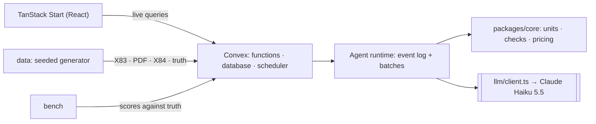

# Preisspiegel — Technical Architecture

Each section says whether it is **built** or **planned**. [HANDOVER](HANDOVER.md) has the current state.

## 1. System overview



The web app subscribes to Convex queries, so every row updates as the run writes it. The agent runtime is Convex functions: actions call the model, mutations write the event log, and the scheduler chains the batches. All judgment that decides accept or flag is pure code in `packages/core`.

## 2. Repository layout (built)

```
apps/web/              TanStack Start app: routes, components, styles/tokens.css
services/backend/      Convex project: convex/schema.ts, convex/llm/, later agent/ pipeline/ ingest/
packages/core/         Pure TypeScript shared by backend, bench and generator
data/                  Seeded generator and data/seed/ (committed demo files)
bench/                 Benchmarks, the provider probe, bench/results/*.json
docs/                  PRD, ARCHITECTURE, BUILD_PLAN, DECISIONS, DATA, DEMO_SCRIPT, HANDOVER
scripts/               Gate tooling: screenshot.ts
```

### Task runner

Root `package.json` scripts are the only entry points.

| Command                 | Does                                                                                                   |
| ----------------------- | ------------------------------------------------------------------------------------------------------ |
| `pnpm check`            | ESLint, Prettier, typecheck of every project, Vitest                                                   |
| `pnpm dev`              | Convex (local deployment) and the web dev server on :3000                                              |
| `pnpm build`            | Production build of the web app                                                                        |
| `pnpm shots [path ...]` | Screenshots at 390 px and 1440 px, light and dark; fails on console errors or overflow                 |
| `pnpm probe:llm`        | One cheap call per provider capability; writes `bench/results/provider_probe.json`                     |
| `pnpm env:push`         | Copies `.env.local` to the Convex deployment's environment                                             |
| `pnpm seed`             | Writes `data/seed/` from the seed, parses it back and loads Convex. `generate` and `load` run one half |
| `pnpm bench`            | M2                                                                                                     |

## 3. Backend (services/backend)

**Built:** the model layer (§5) with `llmLedger` and `llmSpend`; typed deployment env in `convex/convex.config.ts`; `health:get`; the tender tables below, loaded by `pnpm seed`, with `tenders:get`, `positions:list` and `positions:get`.

| Table                  | Holds                                                                         |
| ---------------------- | ----------------------------------------------------------------------------- |
| `tenders`, `documents` | A tender and its source files, with line counts                               |
| `positions`            | LV positions: ordinal number, title path, short and long text, quantity, unit |
| `offerLines`           | Supplier lines as read from the document, with the source of every field      |

Rows refer to their tender by slug (ADR-15).

**Planned (M2):**

| Table               | Holds                                                                                         |
| ------------------- | --------------------------------------------------------------------------------------------- |
| `matches`           | Status, reason codes, candidates with check results, pricing breakdown, evidence, who decided |
| `runs`, `runEvents` | The append-only event log                                                                     |

**Agent runtime (planned, M2).** A run processes positions in batches. One action handles a batch concurrently, writes its events, and schedules the next batch. Steps are idempotent per run and position, so a run resumes after a failure. The event log is what the UI shows live and what replay mode plays back.

## 4. Pipeline (planned, M2)

```
position ─► candidates (BM25 over offer lines)
         ─► matcher: typed attributes for both sides, each with a verbatim quote, and a proposal
         ─► quote verification: every quote must be a substring of its source
         ─► deterministic checks ─► reason codes
         ─► auto-accept (all checks pass) | review queue
         ─► pricing: material + labor + surcharge
```

**Reason codes:** `SPEC_MISMATCH`, `UNIT_BASIS`, `PRICE_OUTLIER`, `QTY_MISMATCH`, `ALTERNATIVE_PRODUCT`, `NO_OFFER`, `AMBIGUOUS`, `ARITHMETIC`.

**Built so far**, all in `packages/core`:

- `gaeb.ts` reads and writes GAEB DA XML 3.2, phases 83 and 84, and turns a file into positions or offer lines. Each offer line points at the XML element every field came from.
- `pdfTable.ts` reads an offer table out of PDF text. It finds the header row by what German offers call their columns, assigns text to columns by alignment, joins continuation lines, and keeps the page and rectangle of every field. It splits runs of numbers that a PDF reader merged across columns.
- `numbers.ts` parses and formats German numbers. A value that does not look like a number is `null`, never a guess.
- `units.ts`. Three-phase apparent power to line current, I = S / (√3 · U). A cabinet offered as 138 kVA carries about 199 A at 400 V, which is how an offer in kVA is compared with a requirement in amps.

## 5. Model layer (built)

**Every provider and model choice is an environment variable. No model ID or SDK client is created outside `services/backend/convex/llm/registry.ts`.** The defaults favour cost, and swapping is a one-line change.

### 5.1 Provider

One code path: the official `@anthropic-ai/sdk`, pointed at the chosen provider.

| `LLM_PROVIDER`         | Client                                                                                                 | Model IDs                                                                                   |
| ---------------------- | ------------------------------------------------------------------------------------------------------ | ------------------------------------------------------------------------------------------- |
| `openrouter` (default) | `new Anthropic({ baseURL: 'https://openrouter.ai/api', authToken: OPENROUTER_API_KEY, apiKey: null })` | `claude-haiku-5-5` → `anthropic/claude-haiku-5.5`, and likewise for Sonnet 5.5 and Opus 5.5 |
| `anthropic`            | `new Anthropic({ apiKey: ANTHROPIC_API_KEY })`                                                         | canonical IDs as they are                                                                   |

- Env vars always hold **canonical IDs**. The registry maps them per provider. An ID that contains `/` passes through untouched on OpenRouter.
- **Capability flags:** `effort`, `structured_outputs`, `strict_tools`, `prompt_cache`. Call sites check a flag and never branch on the provider name. A flag is switched off with `LLM_CAPS_OFF=effort,prompt_cache`; a misspelt name is an error.
- **The probe** (`pnpm probe:llm`) makes one cheap call per capability on the matcher model and records the results. A failed check names the flag to switch off.
- Attribution headers to OpenRouter (`X-Title`, `HTTP-Referer`) are sent only when `OPENROUTER_APP_NAME` or `OPENROUTER_SITE_URL` is set.

### 5.2 Roles

| Role         | Env var                  | Default            | Effort   | Used for                                                            |
| ------------ | ------------------------ | ------------------ | -------- | ------------------------------------------------------------------- |
| Matcher      | `LLM_MATCH_MODEL`        | `claude-haiku-5-5` | `low`    | One call per position: typed attributes with quotes, and a proposal |
| Escalation   | `LLM_ESCALATION_MODEL`   | off                | `medium` | Second read of positions the matcher could not settle               |
| Investigator | `LLM_INVESTIGATOR_MODEL` | `claude-haiku-5-5` | `low`    | Drafts a resolution for a flagged position                          |

`LLM_<ROLE>_EFFORT` overrides the effort. A unit test asserts that no role defaults to a larger model.

**Ladder:** deterministic checks → matcher → escalation model, if one is set → the review queue. With escalation off, unsettled positions go straight to the estimator.

**Price table** (USD per million tokens, Anthropic first-party rates, checked 2026-11-16; kept in `registry.ts` for the cost meter):

| Model                                          | Input | Output | Cache read | Cache write (5 min) |
| ---------------------------------------------- | ----- | ------ | ---------- | ------------------- |
| `claude-haiku-5-5`                             | 0.10  | 0.50   | 0.01       | 0.125               |
| `claude-haiku-5-5`, prompt over 100,000 tokens | 0.50  | 2.50   | 0.05       | 0.625               |
| `claude-sonnet-5-5`                            | 2.00  | 10.00  | 0.10       | 2.50                |
| `claude-opus-5-5`                              | 4.00  | 20.00  | 0.20       | 5.00                |

**Swap examples**

```bash
# Go direct to Anthropic instead of OpenRouter (same model IDs)
LLM_PROVIDER=anthropic ANTHROPIC_API_KEY=sk-ant-...
# Turn escalation on for the positions the matcher could not settle
LLM_ESCALATION_MODEL=claude-sonnet-5-5
# A stronger matcher, for a comparison run
LLM_MATCH_MODEL=claude-sonnet-5-5
```

**API rules for the current models**

- Thinking is adaptive. No `budget_tokens`, `temperature`, `top_p` or `top_k`. Depth is set with `output_config.effort`.
- No forced `tool_choice`. Structured output uses `client.messages.create()` with `zodOutputFormat`, and the answer is read by `readStructured` (ADR-24); tools use `auto` plus `strict: true`.
- `stop_reason` is checked before content is used. `refusal`, `max_tokens` and an unparsed result are returned as typed failures, not thrown.
- The system prompt is a frozen prefix with a cache breakpoint. Per-call content goes in the user turn.

**One call path.** `llm/client.ts` exposes `llmParse(ctx, { role, system, user, schema, runId })`. It checks the daily budget, calls the provider with `messages.create`, writes the ledger row, and only then reads the answer with `readStructured`, which never throws: a refusal, a cut-off and text that does not fit the schema all come back as typed failures (ADR-24). Nothing else talks to the SDK. A role that names a model without a price is refused before any call.

**Cost meter.** Every call appends `{ day, at, provider, role, model, tokens by kind, usd, stopReason }` to `llmLedger` and adds to that day's row in `llmSpend`, in one mutation. The guard reads the day's total before each call and refuses once `LLM_DAILY_BUDGET_USD` is reached. Rows carry the run id, so the runtime can enforce the per-run cap (`RUN_MAX_USD`, M2). A call that fails before a response arrives has no usage to record. `llmParse` has not made a real call yet; the first is in M2.

**Estimated budget** (not yet measured; B1 will replace this): a matcher call of about 1,500 prompt tokens, half of them cached, and 600 output tokens costs about $0.0004 on Haiku 5.5, so a 1,170-position tender is about $0.45.

## 6. Frontend (apps/web)

**Built:** TanStack Start with server rendering; TanStack Query bound to Convex through `@convex-dev/react-query`, so a query is rendered on the server and stays live in the browser. Tailwind v4 with tokens in `src/styles/tokens.css` exposed as utilities. Archivo (variable) and IBM Plex Mono, self-hosted. Motion comes from `motion`; counting figures from `@number-flow/react`. Theme and locale toggles without a flash of the wrong theme (ADR-11). The design direction is "Schaltplan" (ADR-26, [PRD §7](PRD.md#7-ux-principles-and-design-direction)); components are built by hand on the tokens (ADR-21).

- **Overview** (`/`): the tender as a single-line diagram. `lib/schematic.ts` lays it out in drawing units and is tested; `components/overview/Schematic.tsx` only draws and animates. Each feeder links to its title's positions. Below 1024 px the same distribution is a list.
- **Positions** (`/positionen`, `/positionen/$oz`): a virtualised, searchable list (TanStack Virtual, ADR-28) that is one Tab stop; the open position; and one row per offer with its price, which opens to quantity, list price, discount, total and article number. A wide screen opens the first position by itself.
- **Source:** every underlined value is a link (`?quelle=a.0.unitPrice`), so a link to a position can carry its marked source. For a PDF, `pdfjs-dist` renders the page, never narrower than 640 px, scrolled to the rectangle the value was read from; for a GAEB file the item's own lines are shown, numbered as in the file, with the element marked. Below 1800 px the list gives its room to the document while a source is open (ADR-31); on a phone the document is a sheet from below.
- **Jump:** ⌘K finds a position by ordinal number or text. J and K step through the list.
- **Reduced motion:** `lib/pace.ts` keeps the starting state of every animation in the markup and removes the way there, so server and browser render the same thing and nothing waits for an animation.
- **Checks:** `pnpm shots` (four widths, both themes, console errors, overflow) and `pnpm probe:ui` (keyboard, focus, hand-typed addresses, units, language, reduced motion). Contrast is a unit test over the tokens.

**Planned:** the split and euros at risk on the overview, the review queue, tripped switches and the arithmetic on flagged offers, live status in the list during a run, Kalkulation with the copper control, run replay, `/bench`. All of these need the pipeline's results (M2).

**Known costs:** the list query sends all positions (about 280 kB for 1,170); status for a live run must be a separate query. The GAEB source downloads the whole file to show one item; the excerpt should come from Convex.

## 7. Hosting (planned, M4)

Web app on Vercel, backend on a Convex cloud deployment. The public site runs in replay mode; live runs need the access code.

## 8. Security notes

- Secrets live in `.env.local` and in the Convex deployment environment. Neither is committed, and neither reaches a prompt or a log.
- Only `VITE_*` and `CONVEX_URL` reach the browser bundle.
- Every model call is metered and capped per day; the public demo makes none.
- All data is synthetic. There is no personal data.

## 9. How this maps to a production system

| Demo                          | Production                                                      |
| ----------------------------- | --------------------------------------------------------------- |
| One synthetic tender          | Tenants, projects, permissions, audit log                       |
| Generated catalogue           | Datanorm, ETIM and BMEcat imports; wholesaler price feeds       |
| Two PDF layouts               | Layout-agnostic extraction, OCR for scans                       |
| Ground truth from a generator | Estimator decisions as labels, fed back into evaluation         |
| Replay mode                   | Durable runs with retries, alerting and cost budgets per tenant |
